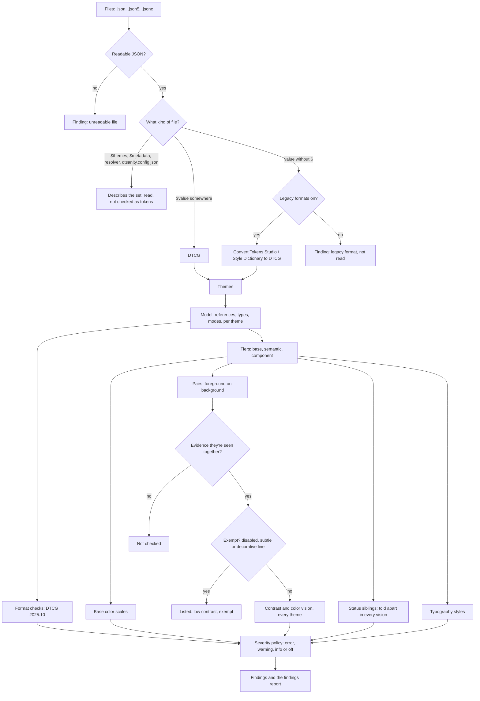

# How DTsanity reads a token system

This is the reasoning DTsanity follows when it is given a set of design token
files: what it decides at each step, from what evidence, and where that
decision lives in the code. It is written for anyone who wants to understand
a finding, disagree with one, or adapt DTsanity to their own system. DTsanity
is open source: change what doesn't fit you.

Three ideas run through every step:

- **Precision over coverage.** DTsanity doesn't try to find every issue. It
  tries to report only what it can stand behind. Where the files don't say
  enough, it says nothing rather than guess.
- **Names state intent; what tokens do confirms it.** A group, file or folder
  name says what a token is meant to be. Its value and references say what it
  does. Where the two disagree, DTsanity reports the disagreement, with its
  reason, and doesn't silently pick one.
- **Findings are flags.** Your design system's rules come first. A finding is
  closed when its check passes, or when you decline it with your reason.

How these rules were reached, and on which design systems they were tested, is
in [the maturity record](../corpus/README.md) and [its decisions](../corpus/decisions.md).

## The path, step by step



### 1. Reading the files

Every file is parsed by a lossless parser that keeps key order and formatting,
so a fix changes only the lines it is about. JSON5 and JSONC are read when the
file is named so, or when strict JSON fails. A file that can't be read at all
is a finding of its own.

Some files describe the set rather than hold tokens, and are read but not
checked as tokens: Tokens Studio's `$themes.json` and `$metadata.json`, a DTCG
resolver (`*.resolver.json`, or any file with a `resolutionOrder`), and
DTsanity's own `dtsanity.config.json`.

*Code: `src/io/load.ts`, `src/json/cst.ts`, `src/model/format.ts`.*

### 2. Telling the format

- **DTCG**: the file has `$value` somewhere.
- **Legacy** (Tokens Studio, Style Dictionary v3): it has `value` (without the
  `$`) on a non-object.
- **No tokens**: neither.

Legacy files are read only when “Accept legacy formats” is on. They are
converted to DTCG in place: `value` → `$value`, `type` → `$type`, and
`description` or `comment` → `$description`. Anything DTCG has no place for is
kept under `$extensions.com.dtsanity.legacy`, and written back when exported.
A legacy token's own description (a Figma export's `attributes.description`)
is read as its description.

*Code: `src/model/format.ts`, `src/legacy/`.*

### 3. Finding the themes

A theme is one version of the set (light, dark, a brand, high contrast),
checked on its own over the shared files. DTsanity takes the first source that
gives themes, in this order:

1. **A DTCG resolver**: one theme per combination of its modifiers' contexts;
   later files in `resolutionOrder` override earlier ones.
2. **Tokens Studio `$themes`**: each theme combined with the first theme of
   every other group (one size, one typeface, one color scheme…).
3. **File names**: `light`, `dark`, `dim`, `night`, `day`, `high-contrast`, `hc`
   in a file name. Files without a theme word are shared by every theme. A
   theme file whose name extends another's (`dark.dimmed` on `dark`) builds
   on it.
4. **Files that define nearly the same tokens** (80% or more, at least 10):
   alternatives of one set, one theme each (`sap_horizon`, `sap_horizon_dark`).
5. **Per-mode values in `$extensions`** (`mode`, or `<vendor>.modes`).

A theme named high or increased contrast (`hc`, `hcb`, `hcw` too) is checked at
the enhanced contrast level. You can change any of this on the Themes page.

*Code: `src/themes/detect.ts`. Tunable: `THEME_WORD`, `HIGH_CONTRAST`,
`SAME_TOKENS`, `MIN_TOKENS`.*

### 4. Building the model

For each theme: every token's path, its `$type` (its own, inherited from a
group, or taken from what it points at), its references (`{a.b}` and `$ref`
pointers), `$extends`, and its value in that theme with every reference
resolved. References and types are what most later steps stand on.

*Code: `src/model/build.ts`, `src/model/modes.ts`.*

### 5. Format checks

The DTCG 2025.10 rules: structure, names, types, values, references and
metadata. These are **required**: they come from the standard, and a file that
breaks them is one other tools may not read. Where the right fix is certain, a
one-click fix is offered.

*Code: `src/validate/`, the list in `src/policy/rules.ts`.*

### 6. Reading tiers

Every token is read as **base** (raw values, a palette), **semantic** (what a
value is for) or **component** (one component's use of it), from two signals
that check each other:

- **Names state intent.** A tier word in the token's top groups, then its file
  name, then its folders, nearest first: `primitives`, `base`, `core`,
  `palette`… (base), `semantic`, `system`, `functional`… (semantic),
  `components`… (component). The token's own leaf name doesn't count.
- **Behavior is the default.** A raw value reads as base, a reference as
  semantic, a component word in the name (`button`, `card`…) as component.

A clear name decides. Behavior decides only where no name says anything;
where the word means different tiers in different systems (`alias`, `global`,
`core`: the whole group's behavior settles it); or where a base-named file
holds two tiers (one group pointing at another). When a clearly named group is
contradicted by its tokens as a whole, DTsanity asks once
(`tier-name-mismatch`) instead of overriding the name. Every tier shown says
why it was read so.

Then the reference rules: base tokens hold values; semantic tokens point at
base or semantic ones; component tokens at semantic or base ones.

*Code: `src/model/tiers.ts`. Tunable: `BASE`, `SEMANTIC`, `COMPONENT_GROUP`,
`COMPONENTS`, `AMBIGUOUS`.*

### 7. Base color scales

A base color with a literal value belongs to the palette of its parent group:
`color.blue.500` is step `500` of `color.blue`. Groups that read as semantic by
name (`bg`, `text`, `status`…) are left out, and so are state steps
(`500-hover`). Colors whose names follow no scale form one only if they look
like a ramp: lightness moving one way and hues within 60° of each other. Each
scale is checked in OKLCH:

| Check | Flagged when |
|---|---|
| Inversion | lightness doesn't move one way across the steps |
| Near duplicate | neighbours closer than 0.02 in OKLab (and not just different opacities) |
| Hue drift | hue wanders more than 30° (colors with chroma above 0.04) |
| Uneven lightness, missing steps, unordered | gaps or step names that don't follow the scale |
| Gamut | colors outside sRGB (or P3, as set) |

Scale findings are design observations, mostly **advice**.

*Code: `src/palette/detect.ts`, `src/palette/checks.ts`. Tunable:
`SEMANTIC_NAMES`, `STATE_STEP`, `MAX_HUE_SPREAD`, `NEAR_DUPLICATE`, `HUE_DRIFT`,
`CHROMATIC`, `L_EPS`.*

### 8. Pairs: what sits on what

Contrast needs two colors seen together, and token files rarely say which.
DTsanity infers pairs from names, then keeps only those the system gives
evidence for.

**From names.** A name is read as words. Its last role word gives its role:
a background (`bg`, `background`, `surface`, `fill`, `canvas`, `container`…) or
a foreground (`text`, `fg`, `content`, `label`, `link`, `on`… for text; `icon`,
`border`, `outline`, `stroke`, `divider`… for UI parts). The other words are
its modifiers. A foreground pairs with the backgrounds that share its
modifiers (`text.danger` with `bg.danger`); with none, with the default
background. A border pairs with the default backgrounds, around its shape,
never with the fill inside it (WCAG 1.4.11). `on-primary` pairs with
`primary`. Words like `color`, `default`, `theme` are ignored.

**Then evidence.** A pair is checked only where the system shows it is seen
together:

- A token whose **description** puts it on a surface (“text on subtle accent
  backgrounds”, “on a dark background”, “on layer 01”) pairs only with
  backgrounds of that surface. With none of them, it isn't checked.
- A **fully transparent** foreground or background isn't measured: nothing is
  drawn, or what is under it isn't known.
- A color **the same as its background** isn't a pair: it is hidden on purpose,
  or two roles share a color.
- A **translucent** background is blended over the page background first, as a
  screen shows it.

**Exempt pairs.** A disabled or inactive state, or a line named subtle, muted,
faint or decorative (a divider, a separator), is listed as “Low contrast,
exempt”, not counted: WCAG doesn't require contrast of them.

**Levels**, in every theme:

| | Text | UI parts and borders |
|---|---|---|
| WCAG 2.2, standard | 4.5:1 (AA) | 3:1 |
| WCAG 2.2, enhanced (high-contrast themes) | 7:1 (AAA) | 3:1 |
| APCA, standard | Lc 60 | Lc 45 |
| APCA, enhanced | Lc 75 | Lc 60 |

APCA is the method proposed for WCAG 3, not yet a standard, so with APCA
selected contrast findings are advice. You can add, remove or retype any pair
in the app.

*Code: `src/semantic/pairs.ts`, `src/state/pairs.ts`, `src/contrast/levels.ts`.
Tunable: `BG`, `TEXT`, `UI`, `EDGE`, `NOISE`, `INVERSE`, `STATES`, `INACTIVE`,
`LOW_EMPHASIS`, `describedSurface`.*

### 9. Color vision

Every pair is also measured as people with protanopia, deuteranopia and
tritanopia see it (Machado, Oliveira & Fernandes 2009, at full severity, so a
pair that passes here passes milder forms too) and with achromatopsia
(luminance only). A pair that passes with typical vision but not under a
simulation is `cvd-pair`.

**Status siblings**: tokens whose names differ only in a status word (`danger`,
`error`, `warning`, `caution`, `success`, `info`…) must stay told apart: their
two closest members must differ by at least 0.1 in OKLab under every vision
type (`cvd-siblings`).

*Code: `src/color/cvd.ts`, `src/semantic/siblings.ts`. Tunable: `STATUS`, and
the distance in settings (`cvdDistance`).*

### 10. Typography

Typography styles are read by DTCG's composite keys (`fontFamily`,
`fontSize`, `lineHeight`…), never by name. Across a range of styles, in each
theme: styles that look the same (`type-same`), neighbouring sizes closer
than 1.1× with the same family and weight (`type-close`), text below 12px
(`type-small`, at a 16px root), and a font stack with no generic fallback
(`font-fallback`).

*Code: `src/semantic/typography.ts`. Tunable: `MIN_PX`, `MIN_STEP`, `ROOT_PX`,
`GENERIC`.*

### 11. Severity

Each check reports at a level: **error** (breaks the DTCG format, or text
fails contrast), **warning** (valid but likely wrong, or a non-text
accessibility failure) or **info** (listed apart, not counted). Each check
also says what it stands on: **required** (a standard: DTCG, WCAG, JSON) or
**advice** (a convention). You can change any check's level, or turn it off,
on the severity policy page or in the configuration file.

*Code: `src/policy/rules.ts` (every check, its level and fix), `src/policy/basis.ts`
(what it stands on), `src/policy/criteria.ts` (problem, done when, decline if).*

### 12. The findings report

“Copy as prompt” turns every remaining finding into one report for an AI
assistant, your own tooling or a ticket. It opens by saying the findings are
flags and your system's rules prevail; each rule then gives what it stands on,
the problem, what must be true when it is done, and when it may be declined;
each finding its place and evidence. It never says how to fix: your system
decides that, and a fresh check confirms it.

*Code: `src/io/prompt.ts`, `src/policy/principles.ts`.*

## Make it yours

### Without changing code: settings and the configuration file

The page keeps your settings in your browser. The offline check reads the
same settings from a file: `--config <file>`, or `dtsanity.config.json` in the
folder it checks. Keep it beside your tokens so everyone checks the same way.
A starting point is [dtsanity.config.example.json](../dtsanity.config.example.json).

| Setting | Values | Default | What it changes |
|---|---|---|---|
| `contrast` | `"wcag"` or `"apca"` | `"wcag"` | The contrast method (step 8) |
| `cvdDistance` | 0–1 | `0.1` | How far apart status siblings must be (step 9) |
| `acceptLegacy` | `true` / `false` | `false` on the page, `true` in the offline check | Read Tokens Studio and Style Dictionary files (step 2) |
| `gamut` | `"srgb"` or `"p3"` | `"srgb"` | The gamut colors are checked against (step 7) |
| `colorFormat` | `"oklch"`, `"hex"`, `"rgb"` | `"oklch"` | How colors are written on screen |
| `policy` | `{ "<check>": "error" \| "warning" \| "info" \| "off" }` | each check's own level | Severity (step 11); check names are in `src/policy/rules.ts` |

```bash
node dist-cli/dtsanity-check.mjs path/to/tokens --config dtsanity.config.json
```

### With a fork: vocabularies and thresholds

Every word list and threshold named under “Tunable” above is a constant at the
top of its file. To adapt DTsanity to a system with its own vocabulary (other
role words, other tier names, other status words), change them there, then:

```bash
npm test                 # the behavior tests, including the reviewed misreadings
npm run corpus -- --check   # every sample system again; fails if a finding reviewed as right is lost
```

### Teaching it your system

To make DTsanity better for systems like yours, and for everyone: add your
token files as a sample, review the findings it gives
([corpus/REVIEWING.md](../corpus/REVIEWING.md)), and propose changes as general
rules that hold across systems ([corpus/README.md](../corpus/README.md)). A
convention only your system has belongs in your configuration, not in
DTsanity's rules.
